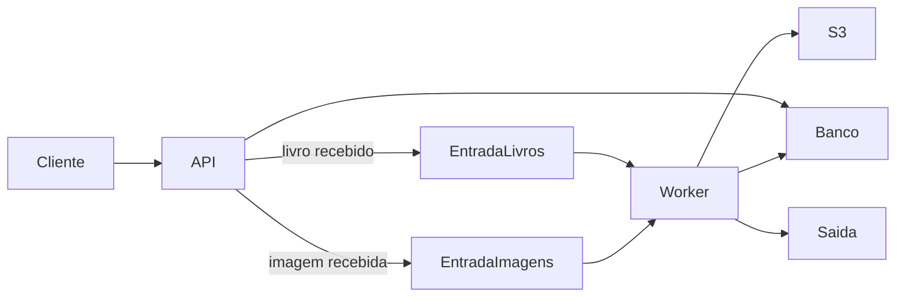

# Onboarding ToT

Implementação dos exercícios de onboarding propostos para o projeto ToT.

O ambiente reúne FastAPI, Floci, S3, SQS, PostgreSQL, CloudBeaver, OpenCV e
Docker Compose.

## Arquitetura



## Como executar

```shell
docker compose up --build
```

Após subir o ambiente:

- API: http://localhost:8000/docs
- Floci UI: http://localhost:4500
- CloudBeaver: http://localhost:8978

## Exemplos

Enviar um livro:

```shell
curl -X POST http://localhost:8000/livros \
  -H "Content-Type: application/json" \
  -d '{
    "id": "12345",
    "titulo": "Lorem Ipsum",
    "autor": "John Doe",
    "ano": 1960,
    "genero": "romance",
    "resumo": "Resumo do livro."
  }'
```

Enviar uma imagem:

```shell
curl -X POST http://localhost:8000/images \
  -F "arquivo=@evidencias/exercicio-06/imagem-original.png"
```

Consultar um livro:

```shell
curl http://localhost:8000/livros/12345
```

Consultar uma imagem:

```shell
curl http://localhost:8000/images/{id}
```

## Evidências

A pasta [evidencias](evidencias/) reúne as evidências dos seis exercícios:

- exercicio-01: configuração e resultado dos buckets S3;
- exercicio-02: filas FIFO, deduplicação e visibilidade;
- exercicio-03: requisição e resposta da API de livros;
- exercicio-04: resultado produzido pelo worker;
- exercicio-05: consultas e status persistidos no PostgreSQL;
- exercicio-06: API, entrada e resultado da binarização da imagem.

### Antes


### Depois


## Testes

```shell
uv run ruff check .
uv run pytest -q
```

## Serviços locais

Os recursos AWS usados pela aplicação são criados automaticamente pelo Floci
quando o ambiente inicia. Consulte
[01-recursos.sh](infra/floci/ready.d/01-recursos.sh) para ver buckets e filas.
