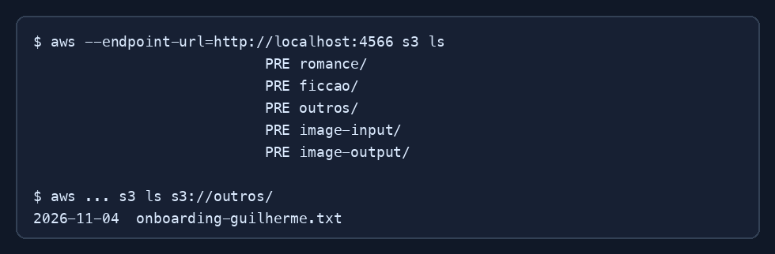

# Exercício 01 - Buckets S3

## Recursos confirmados

O script de inicialização cria:

- `romance`
- `ficcao`
- `outros`
- `image-input`
- `image-output`

## Comandos usados para conferir

```shell
aws --profile floci s3 mb s3://onboarding-guilherme
aws --profile floci s3 ls
aws --profile floci s3 cp teste.txt s3://onboarding-guilherme/
aws --profile floci s3 ls s3://onboarding-guilherme
```

## Resultado esperado

```text
make_bucket: s3://onboarding-guilherme/
upload: teste.txt to s3://onboarding-guilherme/teste.txt
2026-11-04  teste.txt
```


