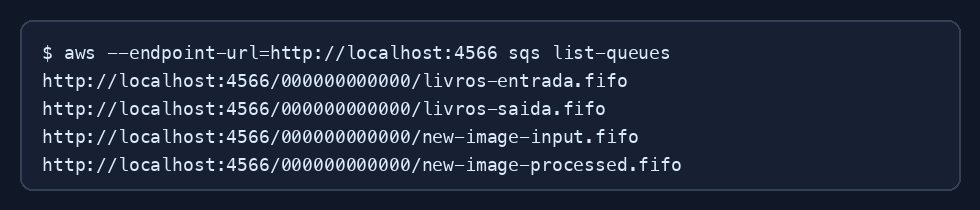

# Exercício 02 - Filas SQS FIFO

## Filas criadas

- `livros-entrada.fifo`
- `livros-saida.fifo`
- `new-image-input.fifo`
- `new-image-processed.fifo`

## Comandos usados

```shell
aws --profile floci sqs create-queue \
  --queue-name InputQueue.fifo \
  --attributes FifoQueue=true,ContentBasedDeduplication=false

aws --profile floci sqs list-queues
```

## Dedupliação

Uma segunda mensagem com o mesmo `MessageDeduplicationId`, enviada dentro da
janela de deduplicação, é considerada duplicada e não chega como duas entregas.

## Visibilidade

Uma mensagem recebida e não apagada fica invisível pelo tempo configurado em
`VisibilityTimeout`. Depois desse período ela pode aparecer novamente na fila.


