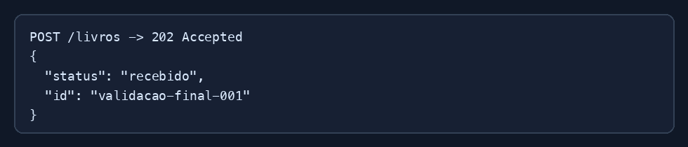

# Exercício 03 - API de livros

## Requisição

```shell
curl -X POST http://localhost:8000/livros \
  -H "Content-Type: application/json" \
  -d '{
    "id": "12345",
    "titulo": "Lorem Ipsum",
    "autor": "John Doe",
    "ano": 1960,
    "genero": "romance",
    "resumo": "Resumo de exemplo."
  }'
```

## Resposta

```json
{
  "status": "recebido",
  "id": "12345"
}
```

Código HTTP: `202 Accepted`.


