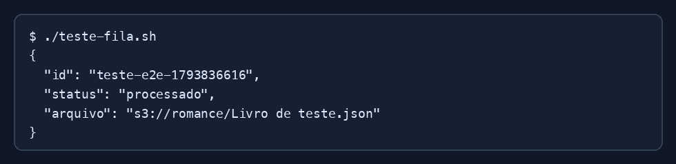

# Exercício 04 - Worker

O worker consulta as filas com long polling de 20 segundos. Para cada livro:

1. recebe o JSON da fila de entrada;
2. escolhe o bucket pelo gênero;
3. monta o nome do arquivo;
4. salva o JSON no S3;
5. envia o resultado para a fila de saída;
6. apaga a mensagem da fila de entrada.

## Resultado esperado

```json
{
  "id": "12345",
  "arquivo": "s3://romance/Lorem Ipsum.json"
}
```

## Arquivos de saída

- `romance/Lorem Ipsum.json`
- `ficcao/{titulo}.json`
- `outros/{titulo}.json`


