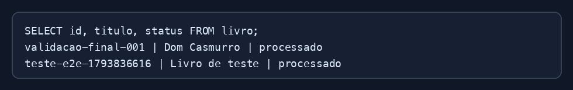

# Exercício 05 - PostgreSQL

## Status acompanhados

- `recebido`: API criou o registro.
- `processado`: worker salvou o JSON no S3.
- `erro`: worker encontrou uma falha.

## Consulta

```sql
SELECT id, titulo, status, atualizado_em
FROM livro
ORDER BY criado_em DESC;
```

## Consultas da API

```shell
curl http://localhost:8000/livros/12345
curl "http://localhost:8000/livros?status=processado"
```


