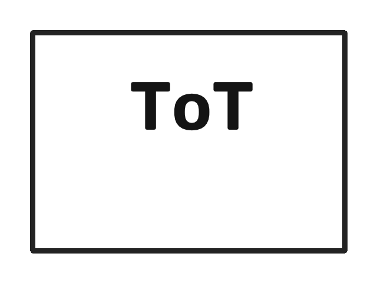
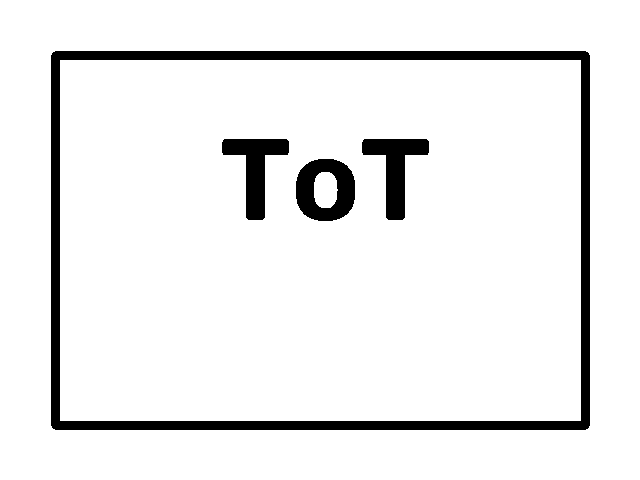

# Exercício 06 - Pipeline de imagens

## Fluxo concluído

1. a API recebe o PNG;
2. salva em `image-input`;
3. registra o status `recebida`;
4. envia o aviso pela fila FIFO;
5. o worker baixa e processa a imagem;
6. salva o resultado em `image-output`;
7. atualiza o status para `processada`.

## Resposta da API

```json
{
  "id": "...",
  "status": "recebida"
}
```

As imagens abaixo mostram o processamento com OpenCV:

## Antes



## Depois


