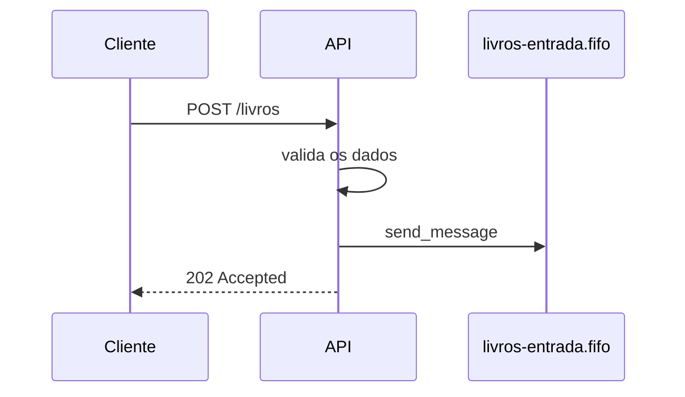

# Exercício 03 · Sua primeira API com FastAPI

**Objetivo:** criar uma API que recebe dados de um livro e envia uma mensagem para uma fila SQS FIFO.

**Antes de começar:** faça o [tutorial oficial do FastAPI](https://fastapi.tiangolo.com/pt/tutorial/) pelo menos até a parte de *Request Body*. Use o [projeto base](../templates/projeto-base/) como ponto de partida.

## O que a API deve ter

### `GET /health`

Responde se a API está no ar, com código HTTP `200` e o corpo:

```json
{"status": "ok"}
```

> Esta rota já existe no projeto base.

### `POST /livros`

Recebe um livro em JSON:

```json
{
  "id": "12345",
  "titulo": "LoremIpsum",
  "autor": "John Doe",
  "ano": 1960,
  "genero": "romance",
  "resumo": "Lorem ipsum dolor sit amet, consectetur adipiscing elit."
}
```

e deve:

1. **validar** os dados usando um modelo Pydantic. Se faltar um campo, ou se `ano` não for um número, o próprio FastAPI responde `422`. Veja [Request Body](https://fastapi.tiangolo.com/pt/tutorial/body/);
2. enviar o livro como mensagem para a fila `livros-entrada.fifo`, usando o `id` como `MessageDeduplicationId`;
3. responder `202 Accepted`, que quer dizer "recebi e vou processar".



## Requisitos

- A fila `livros-entrada.fifo` é criada pelo script em `infra/floci/ready.d/`.
- Tudo sobe com `docker compose up --build`.
- A documentação da API aparece em `http://localhost:8000/docs`. O FastAPI gera isso sozinho, mas capriche nas descrições. Veja [metadados e docs](https://fastapi.tiangolo.com/pt/tutorial/metadata/).
- Pelo menos um teste com `pytest` para cada rota. Veja [testes no FastAPI](https://fastapi.tiangolo.com/pt/tutorial/testing/).
- O código passa no `uv run ruff check .`.

## Dicas

- Deixe o cliente do SQS em um arquivo separado (por exemplo `app/fila.py`). Assim fica mais fácil de testar.
- Para conferir se a mensagem chegou: `aws --profile floci sqs receive-message --queue-url <url>` ou abra o floci-ui.

## Entrega

Um repositório no GitHub com o código, os testes, um README explicando como rodar e a tag `v0.1.0`.
