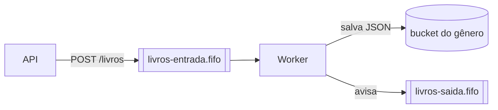

# Exercício 04 · Worker: processando mensagens da fila

**Objetivo:** criar um **worker**, um programa separado da API que fica lendo a fila, processa cada livro e salva o resultado no S3.

**Antes de começar:** termine o [Exercício 03](03-api-fastapi.md). Este exercício continua no mesmo repositório.

## Por que um programa separado?

Processamentos longos (minutos ou horas) **não devem** rodar dentro da API: ela ficaria lenta ou travada. O worker roda no seu próprio container e pode ser reiniciado, ou ter várias cópias, sem afetar a API.



## O que o worker deve fazer

Em um laço sem fim:

1. **Ler** mensagens da `livros-entrada.fifo` com *long polling* (`WaitTimeSeconds=20`). Assim o worker espera a mensagem chegar em vez de perguntar sem parar. Veja [receive_message](https://boto3.amazonaws.com/v1/documentation/api/latest/reference/services/sqs/client/receive_message.html) e [long polling](https://docs.aws.amazon.com/AWSSimpleQueueService/latest/SQSDeveloperGuide/sqs-short-and-long-polling.html).
2. **Converter** o corpo da mensagem (texto JSON) em um dicionário Python.
3. **Salvar** o livro como arquivo `<titulo>.json` no bucket do gênero:
   - `genero = "romance"` → bucket `romance`
   - `genero = "ficcao"` → bucket `ficcao`
   - qualquer outro → bucket `outros`
4. **Enviar** uma mensagem para `livros-saida.fifo` com `{"id": "...", "arquivo": "s3://romance/LoremIpsum.json"}`.
5. **Apagar** a mensagem da fila de entrada. Faça isso **só depois** de tudo dar certo.

## Requisitos

- O worker é um novo serviço no `compose.yaml`, usando a mesma imagem da API e outro comando:

  ```yaml
  worker:
    build: .
    command: ["uv", "run", "--no-sync", "python", "-m", "app.worker"]
    environment:
      # as mesmas variáveis AWS_* da API
  ```

- Buckets e filas são criados no `ready.d` do Floci.
- Se uma mensagem vier com JSON inválido, o worker **não pode parar**. Ele registra o erro no log e segue para a próxima.
- Testes com `pytest` para a função que escolhe o bucket e para a que monta o nome do arquivo.

## Dicas

- Separe a lógica em funções pequenas: `escolher_bucket(genero)`, `salvar_livro(livro)`, `processar(mensagem)`. Funções pequenas são fáceis de testar.
- Use o módulo [`logging`](https://docs.python.org/pt-br/3/howto/logging.html) em vez de `print`, e veja os logs com `docker compose logs -f worker`.
- Para testar ponta a ponta: chame `POST /livros` em `/docs` e procure o arquivo no floci-ui.

## Entrega

Mesmo repositório, com a tag `v0.2.0` e um diagrama da arquitetura no README. Pode ser em [Mermaid](https://docs.github.com/pt/get-started/writing-on-github/working-with-advanced-formatting/creating-diagrams), [Excalidraw](https://excalidraw.com/) ou [draw.io](https://www.drawio.com/).
