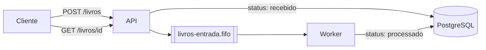

# Exercício 05 · Salvando dados no PostgreSQL

**Objetivo:** guardar no PostgreSQL o **status** de cada livro recebido e permitir que o cliente consulte esse status pela API.

**Antes de começar:** leia o [guia 04: banco de dados](../docs/04-banco-de-dados.md). Este exercício continua o repositório dos exercícios 03 e 04.

## O que muda



1. Crie a tabela `livros` com um modelo SQLModel:

   | Coluna | Tipo | Observação |
   |--------|------|------------|
   | `id` | texto | o `id` que vem no JSON (chave primária) |
   | `titulo` | texto | |
   | `genero` | texto | |
   | `status` | texto | `recebido`, `processado` ou `erro` |
   | `arquivo` | texto, opcional | caminho no S3, preenchido pelo worker |
   | `criado_em` | data e hora | preenchido automaticamente |
   | `atualizado_em` | data e hora | muda a cada atualização |

2. **API, `POST /livros`:** antes de enviar a mensagem para a fila, salva o livro com `status = "recebido"`. Se o `id` já existir, responde `409 Conflict`.
3. **Worker:** depois de salvar o JSON no S3, atualiza o livro com `status = "processado"` e o `arquivo`. Se der erro, usa `status = "erro"`.
4. **API, nova rota `GET /livros/{id}`:** devolve os dados e o status do livro, ou `404 Not Found` se ele não existir.
5. **API, nova rota `GET /livros`:** lista os livros e aceita um filtro opcional `?status=processado`.

## Requisitos

- PostgreSQL e CloudBeaver sobem pelo `compose.yaml`, como no projeto base.
- As tabelas são criadas quando a API inicia. Use `SQLModel.metadata.create_all(engine)`, como mostra o [tutorial do FastAPI](https://fastapi.tiangolo.com/pt/tutorial/sql-databases/).
- A senha do banco vem de variável de ambiente, nunca escrita direto no código.
- Testes para as rotas novas. Dica: nos testes, use um banco SQLite em memória. O tutorial de [testes com banco do SQLModel](https://sqlmodel.tiangolo.com/tutorial/fastapi/tests/) mostra como.

## Para conferir

1. Envie alguns livros pelo `/docs`.
2. Abra o CloudBeaver em `http://localhost:8978` e rode:

   ```sql
   SELECT id, titulo, status, atualizado_em FROM livros ORDER BY criado_em DESC;
   ```

3. Pare o worker (`docker compose stop worker`), envie um livro e veja que ele fica `recebido`. Suba o worker de novo e veja o status mudar para `processado`.

## Entrega

Mesmo repositório, com a tag `v0.3.0` e o diagrama atualizado.
