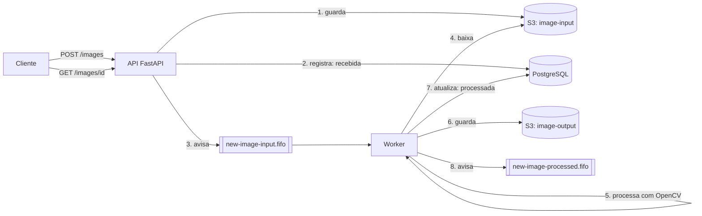

# Exercício 06 · Desafio final: pipeline de imagens

**Objetivo:** juntar tudo o que você aprendeu em um sistema parecido com o que o vddb faz de verdade: receber imagens, processá-las em segundo plano e acompanhar cada etapa.

Comece um **repositório novo** a partir do [projeto base](../templates/projeto-base/).

## O sistema

O cliente envia uma imagem `.png` para a API. A API guarda a imagem no S3, registra no banco e avisa a fila. O worker pega o aviso, processa a imagem com OpenCV, guarda o resultado e avisa que terminou.

## Recursos

| Tipo | Nome |
|------|------|
| Bucket S3 | `image-input` |
| Bucket S3 | `image-output` |
| Fila SQS FIFO | `new-image-input.fifo` |
| Fila SQS FIFO | `new-image-processed.fifo` |
| Tabela PostgreSQL | `images` |

Todos são criados automaticamente quando o ambiente sobe. Os buckets e as filas, pelo `ready.d` do Floci. A tabela, pela API.

## Entregáveis

### API (FastAPI)

- [ ] `GET /health`: responde `200` se a API está no ar.
- [ ] `POST /images`: recebe um arquivo `.png` (veja [Request Files](https://fastapi.tiangolo.com/pt/tutorial/request-files/)), salva no `image-input`, registra no banco com status `recebida`, envia mensagem para `new-image-input.fifo` e responde `202` com o `id` da imagem.
  - Arquivo que não é `.png` → `400` (ou `415`) com uma mensagem clara.
- [ ] `GET /images/{id}`: devolve o status e as datas de envio e de conclusão (`404` se não existir).
- [ ] `GET /images`: lista as imagens e aceita o filtro `?status=`.
- [ ] Documentação OpenAPI em `/docs`, com descrição e códigos de resposta de cada rota.

### Worker

- [ ] Lê `new-image-input.fifo` com long polling.
- [ ] Baixa a imagem do `image-input` e aplica um processamento com OpenCV. Por exemplo, a binarização do [guia 05](../docs/05-imagem-ocr.md).
- [ ] Salva o resultado no `image-output`.
- [ ] Atualiza o banco: status `processada` e data de conclusão. Em caso de falha, status `erro` e a mensagem do erro.
- [ ] Envia mensagem para `new-image-processed.fifo`.
- [ ] Apaga a mensagem da fila de entrada só depois de tudo dar certo.

### Ambiente

- [ ] `docker compose up --build` sobe tudo: API, worker, Floci, floci-ui, PostgreSQL e CloudBeaver.
- [ ] Nenhuma senha escrita no código. Use variáveis de ambiente e um `.env.example`.

### Testes (pytest)

- [ ] Upload de imagem na API (formato válido e inválido).
- [ ] Envio e leitura de mensagem na fila.
- [ ] Processamento da imagem (a função do OpenCV).
- [ ] Atualização de status no banco.

### README do repositório

- [ ] Diagrama da arquitetura (Mermaid, Excalidraw ou draw.io).
- [ ] Como subir o ambiente.
- [ ] Como testar a API: exemplo com `curl` ou com o `/docs`.
- [ ] Onde ver a documentação, os buckets (floci-ui) e o banco (CloudBeaver).
- [ ] Dificuldades encontradas e como você resolveu.

## Extras (opcionais)

- Rodar OCR com Tesseract na imagem processada e salvar o texto no banco.
- Configurar o GitHub Actions para rodar `ruff` e `pytest` em cada PR. Veja a [doc do GitHub Actions](https://docs.github.com/pt/actions) e o [workflow de exemplo deste repositório](../.github/workflows/ci.yml).
- Usar uma [fila de mensagens mortas (DLQ)](https://docs.aws.amazon.com/AWSSimpleQueueService/latest/SQSDeveloperGuide/sqs-dead-letter-queues.html) para mensagens que falharem várias vezes.

## Como trabalhar

- Use o [GitHub Flow](../docs/02-git.md): uma branch e um PR para cada parte (API, worker, banco, testes).
- Use versionamento semântico: comece em `v0.1.0` e chegue em `v1.0.0` quando tudo estiver pronto.
- Anote as dificuldades durante o caminho. Elas vão para o README e ajudam a melhorar este material.
