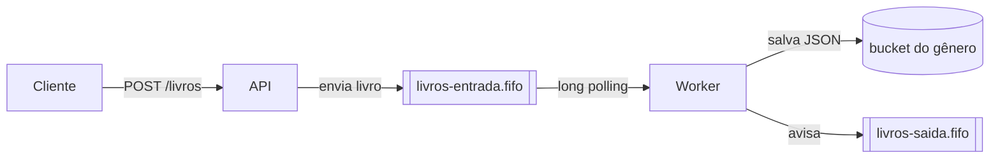

# Trilha_exercicio_TOT

Repositório utilizado para trilha de exercícios do ToT.

## Exercício 03: API de livros com FastAPI

API que recebe os dados de um livro, valida e envia como mensagem para uma fila SQS FIFO (`livros-entrada.fifo`), rodando localmente com o Floci.

### Rotas

| Rota | Função dela |
|------|-----------|
| `GET /health` | Responde `200` com `{"status": "ok"}` quando a API está no ar |
| `POST /livros` | Valida o livro, envia para a fila e responde `202 Accepted` |

Se faltar um campo ou se o `ano` não for um número, a API responde `422`.

Exemplo de corpo para o `POST /livros`:

```json
{
  "id": "12345",
  "titulo": "LoremIpsum",
  "autor": "John Doe",
  "ano": 1960,
  "genero": "romance",
  "resumo": "Lorem ipsum dolor sit amet, consectetur adipiscing elit."
}
```

### Como rodar

Na raiz do repositório:

```shell
docker compose up --build
```

### Testes e Ruff

```shell
uv run pytest
uv run ruff check .
```

## Arquitetura (Exercício 04)



O worker lê a fila de entrada, salva o livro como `<titulo>.json` no bucket do gênero (`romance`, `ficcao` ou `outros`) e avisa na fila de saída. Os logs dele aparecem com `docker compose logs -f worker`.