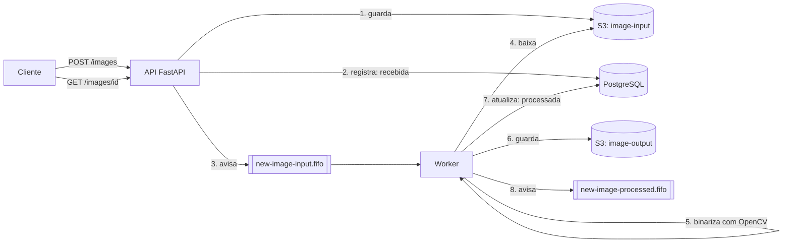

# Pipeline de imagens

Sistema que recebe imagens `.png`, processa em segundo plano com OpenCV e permite acompanhar o status de cada uma. Roda localmente com Docker, usando o Floci para simular a AWS.

## Arquitetura



Resumo do fluxo: ...

## Como subir o ambiente

```shell
docker compose up --build
```

Esse comando já sobe a API, o worker, o Floci, o floci-ui, o PostgreSQL e o CloudBeaver. Os buckets e as filas são criados pelo script em `infra/floci/ready.d/`, e a tabela `images`, pela API ao iniciar.

Para parar: `docker compose down`.

## Onde ver cada coisa

| O quê | Endereço |
|-------|----------|
| Documentação da API (Swagger) | http://localhost:8000/docs |
| Buckets e filas (floci-ui) | http://localhost:4500 |
| Banco de dados (CloudBeaver) | http://localhost:8978 (login `cbadmin`, senha do `.env.example`) |


## Como testar a API

Enviar uma imagem:

```shell
curl -X POST http://localhost:8000/images -F "arquivo=@foto.png"
```

Consultar o status (use o `id` devolvido):

```shell
curl http://localhost:8000/images/ID
curl "http://localhost:8000/images?status=processada"
```

O status passa de `recebida` para `processada` (ou `erro`). O resultado fica no bucket `image-output`, com o mesmo nome do arquivo de entrada.

Um arquivo que não é `.png` recebe `415`.

## Testes

```shell
uv run pytest
uv run ruff check .
```

Os testes não precisam do Docker: o banco é SQLite em memória e a AWS é simulada com o moto.