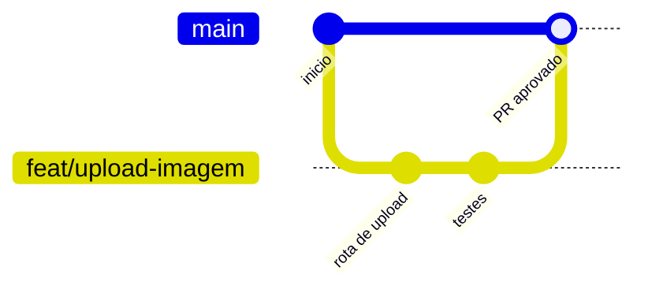

# 02 · Git e GitHub

O **Git** guarda o histórico do código: quem mudou o quê e quando. O **GitHub** é o site onde ficam os repositórios da equipe e onde revisamos o código uns dos outros.

## O básico

Leia os capítulos 1 a 3 do livro oficial [Pro Git (em português)](https://git-scm.com/book/pt-br/v2). Eles cobrem tudo o que você vai usar no dia a dia.

| Comando | O que faz |
|---------|-----------|
| `git clone <url>` | Baixa um repositório |
| `git status` | Mostra o que mudou |
| `git switch -c minha-branch` | Cria uma branch nova e muda para ela |
| `git add <arquivo>` | Prepara o arquivo para o próximo commit |
| `git commit -m "mensagem"` | Salva um "ponto" no histórico |
| `git push` | Envia seus commits para o GitHub |
| `git pull` | Traz as novidades do GitHub |

**Para praticar:** o [Learn Git Branching](https://learngitbranching.js.org/?locale=pt_BR) é um jogo interativo para treinar branches. Não é documentação oficial, mas ajuda muito a visualizar.

## Como trabalhamos: GitHub Flow

Usamos o [GitHub Flow](https://docs.github.com/pt/get-started/using-github/github-flow), um fluxo simples:

1. A branch `main` sempre funciona.
2. Para cada tarefa, crie uma branch a partir da `main`, por exemplo `feat/upload-imagem`.
3. Faça commits pequenos e frequentes.
4. Abra um **Pull Request (PR)** quando quiser que alguém revise. Veja [como criar um PR](https://docs.github.com/pt/pull-requests/collaborating-with-pull-requests/proposing-changes-to-your-work-with-pull-requests/creating-a-pull-request).
5. Depois da aprovação, o PR é juntado (*merge*) na `main`.



## Mensagens de commit

Use o padrão [Conventional Commits](https://www.conventionalcommits.org/pt-br/v1.0.0/). A mensagem começa com o **tipo** da mudança:

| Tipo | Quando usar | Exemplo |
|------|-------------|---------|
| `feat` | Nova funcionalidade | `feat: adiciona rota de upload` |
| `fix` | Correção de erro | `fix: corrige nome do bucket` |
| `docs` | Só documentação | `docs: explica como rodar os testes` |
| `test` | Só testes | `test: cobre processamento de imagem` |
| `refactor` | Melhora o código sem mudar o comportamento | `refactor: separa cliente S3 em módulo` |
| `chore` | Configuração e tarefas gerais | `chore: atualiza dependências` |

## Versões: SemVer

Para numerar as versões do software usamos o [Versionamento Semântico (SemVer)](https://semver.org/lang/pt-BR/): `MAIOR.MENOR.CORREÇÃO`, por exemplo `1.4.2`.

- **MAIOR** (`2.0.0`): mudança que quebra o que já funcionava.
- **MENOR** (`1.5.0`): funcionalidade nova que não quebra nada.
- **CORREÇÃO** (`1.4.3`): correção de erro.

Para marcar uma versão, crie uma *tag* e envie para o GitHub:

```shell
git tag v0.1.0
git push origin v0.1.0
```

Veja também [releases no GitHub](https://docs.github.com/pt/repositories/releasing-projects-on-github/about-releases).

## O que nunca vai para o Git

- Senhas, tokens e chaves de acesso.
- Arquivos `.env`. Envie um `.env.example` com valores de exemplo no lugar.
- A pasta `.venv` e arquivos gerados (`__pycache__`, etc.).

Use um arquivo [`.gitignore`](https://docs.github.com/pt/get-started/git-basics/ignoring-files) para isso. O [projeto base](../templates/projeto-base/.gitignore) já tem um pronto.

> Enviou um segredo por engano? Avise a equipe na hora. Apagar o arquivo não basta, porque ele continua no histórico. A senha ou o token precisa ser trocado.

## Atividades

- [ ] Praticar os níveis "Introdução" e "Push & Pull" do Learn Git Branching.
- [ ] Criar um repositório no GitHub para os exercícios da trilha, com README e a tag `v0.1.0`.
- [ ] Abrir um PR no seu próprio repositório e fazer o merge.
