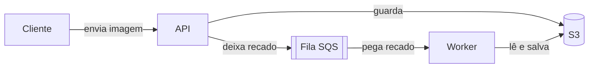

# 03 · AWS no seu computador com Floci

O vddb usa serviços da **AWS** (a nuvem da Amazon). Para estudar e desenvolver sem custo e sem precisar de uma conta na AWS, usamos o **Floci**: um programa que roda no Docker e **imita** a AWS no seu computador.

- [Documentação do Floci](https://floci.io/floci/) · [GitHub](https://github.com/floci-io/floci) (licença MIT, gratuito)
- [floci-ui](https://github.com/floci-io/floci-ui): uma tela no navegador para ver o que você criou no Floci

> Em materiais antigos você vai encontrar o **LocalStack**. A ideia é a mesma, mas a versão gratuita dele deixou de existir em 2026. Por isso trocamos para o Floci.

## Os serviços que usamos

| Serviço | O que é | Exemplo no vddb |
|---------|---------|-----------------|
| **S3** | "Pasta na nuvem" para guardar arquivos. Cada pasta principal se chama **bucket**. | Guardar as imagens enviadas |
| **SQS** | **Fila de mensagens**: um programa deixa um recado e outro pega depois. | Avisar que chegou uma imagem nova |

Na AWS também existem SNS, Lambda, ECS e outros serviços. Comece por S3 e SQS. Os outros aparecem com o tempo. Veja a [lista de serviços da AWS](https://docs.aws.amazon.com/).

### Por que usar filas?

Imagine que processar uma imagem leva 1 minuto. Se a API esperasse esse tempo, quem enviou a imagem ficaria travado. Com uma fila:



A API responde na hora, e o **worker** (um programa separado) faz o trabalho pesado no tempo dele.

### Filas FIFO

**FIFO** significa *First In, First Out*: as mensagens saem na **mesma ordem** em que entraram, e cada uma é entregue uma vez só. Nas filas FIFO:

- o nome **termina com `.fifo`**;
- toda mensagem precisa de um `MessageGroupId`, que define o grupo onde a ordem é garantida;
- toda mensagem precisa de um `MessageDeduplicationId`, um identificador único para evitar duplicatas. A outra opção é ativar `ContentBasedDeduplication` na fila.

Leia: [Filas FIFO na documentação da AWS](https://docs.aws.amazon.com/AWSSimpleQueueService/latest/SQSDeveloperGuide/sqs-fifo-queues.html).

## Subindo o Floci

Crie um arquivo `compose.yaml`:

```yaml
services:
  floci:
    image: floci/floci:2.3.0-compat
    ports:
      - "4566:4566"

  floci-ui:
    image: floci/floci-ui:0.7.0
    ports:
      - "4500:4500"
    environment:
      FLOCI_ENDPOINT: http://floci:4566
    depends_on:
      - floci
```

E rode:

```shell
docker compose up -d
```

> Usamos a imagem `-compat` porque ela já traz a AWS CLI e o boto3. Isso permite criar buckets e filas automaticamente quando o Floci sobe (veja abaixo). Mais detalhes em [imagens Docker do Floci](https://floci.io/floci/configuration/docker-images/).

**Teste:**

```shell
curl http://localhost:4566/_floci/health
```

A resposta é um JSON com os serviços e `"running"` em cada um. Abra também `http://localhost:4500` para ver o floci-ui.

## Usando com a AWS CLI

Com o perfil `floci` configurado no [guia de ambiente](01-ambiente.md#perfil-floci):

```shell
aws --profile floci s3 mb s3://meu-bucket                # cria um bucket
aws --profile floci s3 cp foto.png s3://meu-bucket/      # envia um arquivo
aws --profile floci s3 ls s3://meu-bucket                # lista os arquivos

aws --profile floci sqs create-queue --queue-name minha-fila.fifo \
  --attributes FifoQueue=true
aws --profile floci sqs list-queues
```

Documentação: [comandos s3](https://docs.aws.amazon.com/cli/latest/reference/s3/) · [comandos sqs](https://docs.aws.amazon.com/cli/latest/reference/sqs/).

## Usando no Python com boto3

O [boto3](https://boto3.amazonaws.com/v1/documentation/api/latest/index.html) é a biblioteca oficial da AWS para Python. Ele lê a variável `AWS_ENDPOINT_URL` e, quando ela aponta para o Floci, o **mesmo código** funciona no seu computador e na AWS de verdade.

```shell
export AWS_ENDPOINT_URL=http://localhost:4566
export AWS_DEFAULT_REGION=us-east-1
export AWS_ACCESS_KEY_ID=test
export AWS_SECRET_ACCESS_KEY=test
```

```python
import boto3

s3 = boto3.client("s3")
s3.upload_file("foto.png", "meu-bucket", "foto.png")

sqs = boto3.client("sqs")
url = sqs.get_queue_url(QueueName="minha-fila.fifo")["QueueUrl"]
sqs.send_message(
    QueueUrl=url,
    MessageBody='{"arquivo": "foto.png"}',
    MessageGroupId="imagens",
    MessageDeduplicationId="foto-001",
)
```

> Dentro do Docker Compose, os containers se encontram pelo **nome do serviço**. Por isso, para a sua API, o endereço é `http://floci:4566`, não `localhost`. O [projeto base](../templates/projeto-base/compose.yaml) já faz isso.

Guias do boto3: [S3](https://boto3.amazonaws.com/v1/documentation/api/latest/guide/s3.html) · [SQS](https://boto3.amazonaws.com/v1/documentation/api/latest/guide/sqs.html).

## Criando recursos automaticamente

Coloque um script `.sh` em uma pasta e monte essa pasta em `/etc/floci/init/ready.d`. O Floci roda o script assim que termina de subir. Veja a [doc de initialization hooks](https://floci.io/floci/configuration/initialization-hooks/).

```yaml
  floci:
    image: floci/floci:2.3.0-compat
    volumes:
      - ./infra/floci/ready.d:/etc/floci/init/ready.d:ro
```

Exemplo `infra/floci/ready.d/01-recursos.sh`:

```shell
#!/bin/sh
set -eu
aws s3 mb s3://meu-bucket
aws sqs create-queue --queue-name minha-fila.fifo --attributes FifoQueue=true
```

Dentro do container o Floci já configura a AWS CLI, então não é preciso usar `--profile`. Para conferir se o script rodou: `curl http://localhost:4566/_floci/init`.

## Atividades

- [ ] Fazer o [Exercício 01: S3](../Exercises/01-s3.md).
- [ ] Fazer o [Exercício 02: SQS FIFO](../Exercises/02-sqs-fifo.md).
