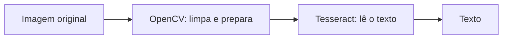

# 05 · Imagens e OCR

Grande parte do ToT envolve transformar **imagens com texto** em **texto que o computador entende**. Para isso usamos duas ferramentas:

- **OpenCV**: trata a imagem (deixa em preto e branco, tira ruído, corrige a inclinação...).
- **Tesseract**: faz o **OCR**, ou seja, lê o texto que aparece na imagem.



Um bom tratamento com OpenCV costuma melhorar muito o resultado do OCR.

## OpenCV

- [Documentação OpenCV 4.x](https://docs.opencv.org/4.x/)
- [Tutoriais para Python](https://docs.opencv.org/4.x/d6/d00/tutorial_py_root.html)
- Pacote Python: [opencv-python-headless](https://pypi.org/project/opencv-python-headless/). A versão *headless* não tem janelas gráficas, e é a indicada para servidores e containers.

```shell
uv add opencv-python-headless
```

Exemplo de **binarização** (deixar a imagem só em preto e branco):

```python
import cv2

imagem = cv2.imread("documento.png")
cinza = cv2.cvtColor(imagem, cv2.COLOR_BGR2GRAY)
_, binaria = cv2.threshold(cinza, 0, 255, cv2.THRESH_BINARY + cv2.THRESH_OTSU)
cv2.imwrite("documento-binario.png", binaria)
```

Leia o tutorial de [Image Thresholding](https://docs.opencv.org/4.x/d7/d4d/tutorial_py_thresholding.html) para entender o que cada opção faz.

## Tesseract (OCR)

- [Documentação do Tesseract](https://tesseract-ocr.github.io/)
- [Instalação](https://tesseract-ocr.github.io/tessdoc/Installation.html) · [Como melhorar a qualidade](https://tesseract-ocr.github.io/tessdoc/ImproveQuality.html)
- Pacote Python: [pytesseract](https://pypi.org/project/pytesseract/)

Use o **Tesseract 5** ou mais novo. No Ubuntu/WSL, instale junto com o idioma português:

```shell
sudo apt install -y tesseract-ocr tesseract-ocr-por
tesseract --version
```

```shell
uv add pytesseract
```

```python
import pytesseract
from PIL import Image

texto = pytesseract.image_to_string(Image.open("documento-binario.png"), lang="por")
print(texto)
```

> No Docker, instale o Tesseract no `Dockerfile` com `apt-get install -y tesseract-ocr tesseract-ocr-por`.

## Atividades

- [ ] Rodar o exemplo de binarização com uma foto de um documento.
- [ ] Comparar o OCR da imagem **original** com o da imagem **binarizada**. Qual ficou melhor?
- [ ] Testar outras opções do tutorial de *thresholding* e anotar o que mudou.
